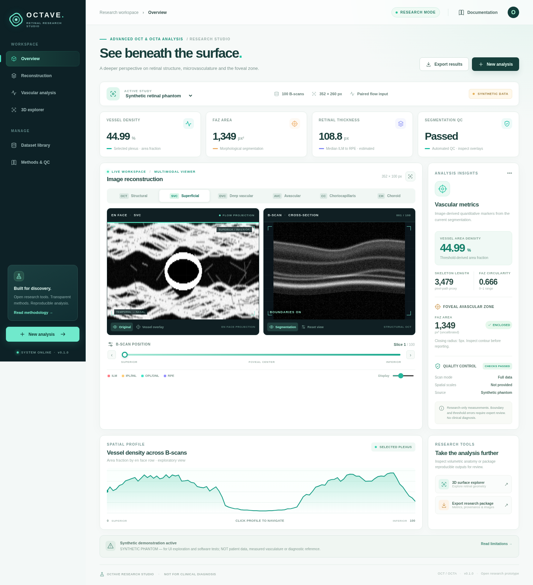

# OCTAVE — Retinal Research Studio

**Open, interactive structural OCT + paired OCTA reconstruction, vascular mapping and FAZ exploration.**



*Explore anatomy and vascular signal in a linked 2D research workspace. [View the interactive 3D retinal-surface preview](docs/screenshots/retinal-surfaces.png).*

A polished full-stack research environment inspired by the transparency of [OCTolyzer](https://github.com/jaburke166/OCTolyzer) and the choroidal analysis goals of [Choroidalyzer](https://github.com/justinengelmann/Choroidalyzer). This is a **research prototype**, **not a medical device**, and its quantitative metrics have **not been clinically validated**.

> **Physiology matters:** structural OCT scans **do not encode measured blood flow**. OCTAVE can always visualize structural OCT and geometric retinal boundaries. To compute vessel masks, FAZ and depth-resolved OCTA maps, you must supply a **registered flow/decorrelation OCTA volume** separately. No synthetic vascular output is misrepresented as a measured OCTA reconstruction.

## Run right now (offline-capable UI)

Requires Python 3.11+ and dependencies (installation may require internet **once**):

```bash
cd backend
python -m venv .venv
source .venv/bin/activate        # Windows: .venv\Scripts\activate
pip install -r requirements.txt
uvicorn app.main:app --host 127.0.0.1 --port 8000 --reload
```

Open **http://127.0.0.1:8000**. The repository contains an immediately served **dependency-free browser build** in `frontend/dist/` (HTML/CSS/JavaScript), so you do **not** need Node to launch the interactive website. It comes with a deterministic **synthetic retinal phantom** clearly labeled as simulated data. Patient files are not bundled or uploaded anywhere by this application.

### Develop the React/TypeScript app

A more extensible React/Vite interface is maintained in `frontend/src/`, featuring Recharts density profiles, Three.js surface rendering and motion effects:

```bash
# Terminal 1 (API)
cd backend && uvicorn app.main:app --reload --port 8000
# Terminal 2 (frontend source)
cd frontend && npm install && npm run dev
# open http://localhost:5173
```

`npm run build` compiles the React version into `frontend/dist/`, replacing the bundled standalone frontend. **The React build requires installing npm dependencies.** In the authoring environment, npm registry access was unavailable, so the React production build was *not independently verified there*. The bundled no-build interface is the tested Python-served entrypoint.

### Docker

```bash
docker compose up --build
# http://127.0.0.1:8000
```

The Compose configuration binds only to loopback and persists derived data in a local named volume. **Do not expose the API to the public internet** without authentication, HTTPS, access controls, retention policies, malware scanning, rate limits and security review.

## What is implemented

| Capability | Status | Interpretation |
|---|---|---|
| Multi-study local dataset library | Working | Synthetic demo + imported data; local server filesystem |
| Import arbitrary numbered B-scans | Working | PNG/TIFF ZIP stacks, `.npy`, `.npz`, multipage TIFF; shape `(scan,depth,width)` |
| Matched OCT and flow volumes | Working | Identical dimensions required; rejects mismatches |
| OCT structural en face | Working | Depth-mean reflectance, **not** blood flow |
| SVC / DVC / avascular / CC / choroid projections | Working with paired flow | Flow-input projections using the supplied OCTA algorithms; some slab boundaries remain proxies |
| Linked en face/B-scan viewer | Working | Layer tabs, B-scan slider, boundary overlay, brightness and zoom |
| Vessel density and length proxy | Exploratory | Image threshold and skeletonized pixel path, not absolute perfusion or true vessel length |
| FAZ mapping | Exploratory | Seeded enclosed non-vessel region; no false zero result for failed detection |
| FAZ seed relocation | Working | Click the SVC en face map to reposition seed |
| Physical scale | Conditional | FAZ mm² requires both lateral scan dimensions; thickness µm needs axial calibration |
| Retinal surface 3D viewer | Working | Geometric **retinal-layer surfaces**, not a reconstructed capillary graph |
| Quality controls | Working | Basic boundary jumps/plausibility, sampling warnings and provenance |
| Export | Working | ZIP of images, boundaries, metadata, CSV metrics, settings and FAZ overlay |
| DICOM / vendor `.vol` | Not built in | Requires a format-specific adapter with reliable physical calibration |
| Trained choroid segmentation | Optional future integration | No weights bundled; current choroid slab uses offset proxies |
| Clinical accuracy | **Not established** | Must validate by scanner type, pathology and annotation |

## Use with the supplied datasets

The uploaded demonstration study included five pairs of archives `OctDenoise-1.zip` through `OctDenoise-5.zip` and `Flow-1.zip` through `Flow-5.zip`. Each archive has 448 B-scan frames of 1024 × 448 pixels. To load one, select **New analysis**, upload `OctDenoise-1.zip` as *Structural OCT* and `Flow-1.zip` as *Paired flow/OCTA*.

The app **does not** ship any of these data archives. This is intentional: uploaded clinical/research images may contain personal or proprietary information.

### Exact acquisition metadata

Provide FOV width and FOV height **only when verified** from the scanner's metadata. If you don't know them, leave blank. `FAZ area = pixel area × (FOV width / image width) × (FOV height / image height)` is computed only with both dimensions available. Do **not** default to a presumed 3×3 mm scan. Axial µm/pixel is likewise required for thickness in physical units.

The default import option uses **up to 128 B-scans** for a responsive preview. For ZIP image stacks, preview sampling decodes only the selected frames; the full source volume is not loaded into memory first. It is explicitly flagged when it samples the stack. For prospective quantitative research, select **Full resolution**, after confirming hardware capacity; process time and memory usage grow with scan dimensions. Note that source volumes must already have matching orientation, scan order and registration; matching shapes alone cannot prove registration.

## API overview

All requests are served locally through FastAPI. A browsable schema is available at **http://127.0.0.1:8000/docs**.

| Method | Endpoint | Description |
|---|---|---|
| `GET` | `/api/health` | Server health |
| `GET` | `/api/datasets` | Dataset library |
| `POST` | `/api/datasets` | Multipart `structural`, optional `flow`, `name`, calibration, `max_slices` (`0` means full resolution) |
| `GET` | `/api/jobs/{id}` | Async processing progress or failure |
| `GET` | `/api/datasets/{id}` | Metadata, QC and pipeline description |
| `GET` | `/api/datasets/{id}/bscan/{index}?overlay=true` | Image with estimated boundaries |
| `GET` | `/api/datasets/{id}/enface/{layer}` | Image (`structural`, `svc`, `dvc`, `avc`, `cc`, `choroid`) |
| `GET` | `/api/datasets/{id}/analyze/{layer}?threshold=52` | Vessel mask metrics and FAZ detection |
| `GET` | `/api/datasets/{id}/mask/{layer}?threshold=52` | Image overlay with vessel mask, seed, FAZ contour |
| `GET` | `/api/datasets/{id}/surface?step=6` | Decimated retinal boundary matrices for 3D |
| `GET` | `/api/datasets/{id}/export?threshold=52` | Reproducibility ZIP and CSV |

### Data layout

```text
OCTAVE input (always 3D)
B-scan / slow axis   Y (e.g. 448)
Depth / axial axis   Z (e.g. 1024)
A-scan / fast axis   X (e.g. 448)
shape = (Y, Z, X)
```

For `.npz`, use array name `structural` or `flow`, or provide only one array. ZIP file names are sorted numerically (`image.0001.png`, `image.0002.png`, …). PNG images are read as 8-bit luminance; high bit-depth numeric volumes are percentile-normalized before segmentation, and this contrast transform makes absolute instrument intensity comparisons invalid. Image orientation is **not** automatically repaired.

## Analysis methods and caveats

1. **Boundaries:** default `app.fast_segmentation.segment_fast` extracts intensity-derived ILM/RPE and geometry-based IPL/INL and OPL/ONL proxies, with smoothing and basic QC. This makes interactive processing feasible but is **not** a validated trained layer segmenter. The original, more complex user-supplied dynamic-programming tracer remains included in `backend/octa_pipeline/`. Set `OCTAVE_SEGMENTER=legacy` to use it; it may be much slower or unsuitable for new scanner geometries.
2. **OCTA reconstruction:** paired flow volumes pass through the provided experimental despeckling, bulk-motion correction, depth-resolved shadow attenuation and anatomical-slab projections. SVC/DVC boundaries remain uncertain when used on unknown devices. The choroid slab is **not** a trained Choroidalyzer region in default mode.
3. **Vessels:** percentile thresholding acts on normalized displayed en face projections. `vessel_density_pct` is the binary *fraction of image area*, **not** flow velocity, clinical perfusion index or unbiased vessel density. Skeleton length is a rough pixel-path metric without diagonal correction.
4. **FAZ:** the algorithm derives a vessel mask from that same SVC image, closes gaps morphologically, takes the connected non-vessel region around a central/thickness-minimum/manual seed, and refuses regions that contact the border or fall outside a size range (0.3%–12% of image). This mirrors the supplied `seg_v6_faz.py` approach. `faz_detected=false` means **not detected**, never an area of zero.
5. **Quality:** image segmentation can be badly wrong despite passing basic automated QC, particularly for fluid, atrophy, poor SNR, unusual acquisition protocols, hardware scaling differences and projection artifacts. Use expert overlays and annotation-based validation.
6. **Provenance:** exported `metadata.json` includes input SHA-256 hashes, scan sampling, processing method and QC. `analysis_settings.json` records threshold and seed. Numeric units are explicitly labeled.

## Repository layout

```text
backend/
  app/main.py                FastAPI, jobs, file endpoints and exports
  app/io.py                  Safe-ish limited ZIP/NPY/TIFF import and shape validation
  app/fast_segmentation.py   Fast experimental boundary estimation
  app/analysis.py            Flow projections, vessel masks, FAZ and metrics
  app/demo.py                Deterministic synthetic phantom, generated locally
  octa_pipeline/             User-supplied experimental Python algorithms (unmodified)
  tests/                     Unit and HTTP smoke tests
frontend/
  dist/                      Shippable zero-build interactive browser UI
  src/                       React + TypeScript + Recharts + Three.js source
  package.json               Node project, optional development pathway
.github/workflows/ci.yml     Python tests and React build job
scripts/                     CLI and smoke-test utilities
docs/                        Methodology and deployment notes
```

## Tests

```bash
cd backend
pip install -r requirements-dev.txt
pytest -q
```

Backend tests cover input validation, FAZ success/failure, physical-unit gating and a FastAPI synthetic-study smoke test. A separate 16-frame processing smoke test against the **uploaded patient-1 structural + flow pair** successfully produced `structural`, `svc`, `dvc`, `avc`, `cc` and `choroid` outputs; that patient data is **not** copied into the repository. The site includes live Python backend endpoints. The React npm build was not executed in the provided no-network environment.

## Privacy, licensing and citation

**Private by default:** local `backend/runtime-data` is generated during use and Git-ignored; no authentication is implemented. De-identify inputs. Do not expose the app as a public service as-is.

New OCTAVE glue, UI and original application code can be used under the project's MIT license. **The `backend/octa_pipeline/` package originated from user-provided source archives and has no license text in the archive; this project does not assert a redistribution license for that material. Confirm the code owner's rights before publication.** Choroidalyzer model code/weights and the unrelated `FAZ_Extraction.zip` are **not** embedded. OCTolyzer is linked as methodological inspiration only—not copied.

Consider citing OCTolyzer: Burke et al., *OCTolyzer: Fully automatic toolkit for segmentation and feature extracting in optical coherence tomography and scanning laser ophthalmoscopy data*, arXiv:2407.14128 (2024), and Choroidalyzer: Engelmann et al., *Investigative Ophthalmology & Visual Science*, 65(6):6 (2024). Use method-specific references and your validation protocol in any publication.

## What would make this suitable for publication-grade generalization?

See `docs/VALIDATION.md` and `docs/PUBLISH_TO_GITHUB.md`: curated expert-labeled multi-device datasets, DICOM/Heidelberg metadata readers, learned retinal boundaries, formal repeatability/reproducibility studies, segmentation correction workflows and stratified performance dashboards.
