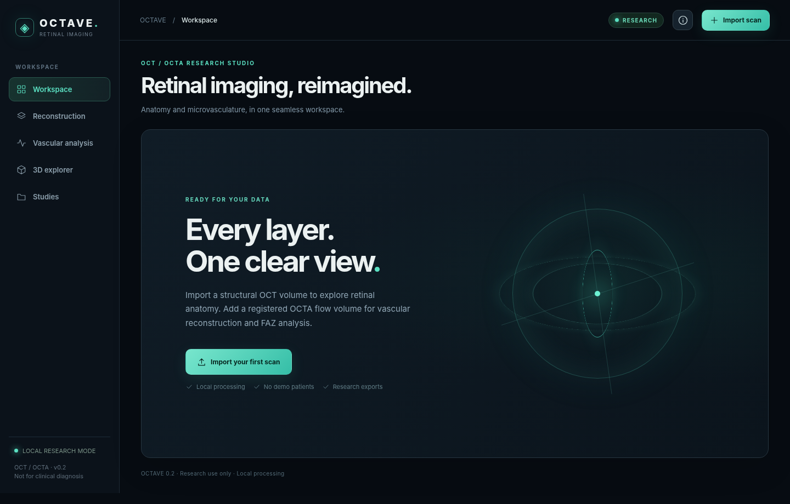

# OCTAVE

**Minimal OCT/OCTA reconstruction, FAZ analysis & retinal imaging workstation.**



> **Research use only. Not clinically validated.** OCTA vessel analysis requires a **separate, registered, real flow/decorrelation volume**; blood flow cannot be recovered from an ordinary structural OCT scan. No sample/patient data, synthetic cases, or external UI assets are included.

## What's new in 0.2

- Complete visual redesign: clean, dark imaging workstation; reduced labels and decorative content; responsive navigation; real data views only.
- The **uploaded v5 reconstruction** now runs by default, not the former fast approximation. Includes dynamic-programming anatomy, bulk-motion correction, projection suppression, SVC/DVC/avascular/CC/choroid projections, and v5 Frangi/CLAHE enhancement.
- **v6 additions:** informational EZC surface in B-scan overlays and interactive 3D, supplied FAZ v2 enclosed-void logic, and exploratory SVC morphometry (skeleton density, caliber proxy, branch endpoints, fractal dimension, FAZ acircularity).
- Optional `OCTAVE_CHOROID=choroidalyzer` switches the choroid slab to trained choroidal boundaries, **only if independently installed and supplied with functioning model weights**. Default v5 choroid projection is plainly labeled as an RPE-offset proxy.
- Corrected percentile vessel mask behavior when v5 display enhancement creates a dominant flat background intensity.
- Eliminated synthetic demo creation and removed the old unverified React dependency path. Frontend is now **one maintained, dependency-free JavaScript/CSS codebase**; CI builds it reproducibly using Node built-ins only.

## Run locally

Python **3.11+** (prefer Python 3.11 for consistency with CI):

```bash
cd backend
python -m venv .venv
source .venv/bin/activate      # Windows: .venv\Scripts\activate
python -m pip install -r requirements.txt
uvicorn app.main:app --host 127.0.0.1 --port 8000
```

Open **http://127.0.0.1:8000**. The **ready-made** `frontend/dist/` is served by FastAPI. Node is *not required* to run the application. Processing and derived scans stay in the local `runtime-data/` directory, which is Git-ignored. The application starts **empty** and requests your own structural images.

### Import a study

1. Choose **Import scan** and a ZIP containing numbered `.png` / `.tif` / `.tiff` B-scans, or a 3-D `.npy`, `.npz`, or TIFF volume.
2. Optionally add a **paired OCTA flow/decorrelation volume**. Same array shape is required, but this does **not** prove registration. The flow input must be truly acquired/derived, not simulated from structural OCT.
3. Use default **v5 reconstruction + v6 analysis**. Choose **Full volume** for final research evaluations. Only choose **Fast exploratory preview** if deliberately trading boundary fidelity for speed.
4. Enter lateral scan width and height (mm) **only from verified acquisition metadata**. Enter axial scale (µm/px) only if verified. Otherwise the site reports pixel units.
5. Review the B-scan overlays, switch SVC/DVC/AVC/CC/choroid layers, adjust vessel threshold, click **FAZ seed** and then click the SVC image, explore 3D surfaces, and export analysis ZIPs.

**Axes:** input array shape `(B-scan index, depth, A-scan width)`. The software does not infer vendor-specific axes or correct orientation. ZIP names sort numerically. For pathologies, different scanners, and unusual image dimensions, the v5 segmenter may fail or produce inaccurate boundaries; **manual review and expert validation remain essential**.

### Website source and frontend CI

```bash
cd frontend
npm run check        # JavaScript syntax, built-in tests, reproducible build
```

There is no npm installation step, lockfile, CDN, or runtime framework. Edit `frontend/src/app.js` and `frontend/src/styles.css` and use `npm run build` to refresh `frontend/dist/`. This intentionally replaces the two competing React and bundled interfaces in the previous release that could diverge.

### Backend tests

```bash
cd backend
python -m pip install -r requirements-dev.txt
python -m pytest -q
```

### Docker

```bash
docker compose up --build
# http://127.0.0.1:8000
```

## Core workflow

| Capability | Implementation | Important caveat |
| --- | --- | --- |
| Structural B-scans | ZIP/NPY/NPZ/TIFF stack, linked view | Single B-scan is not a volume; vendor DICOM/OCT `.vol` adapters not included |
| V5 retinal boundaries | Original uploaded dynamic-programming segmentation | OPL/ONL remains estimated; device/generalization not validated |
| EZC (v6) | Additional image-derived band | Informational; does not replace original v5 slab bounds |
| OCTA slabs | Supplied v5 algorithms + enhancement | Requires paired, already calculated flow/OCTA volume |
| Choroid | v5 RPE-offset projection; optional Choroidalyzer | Real model weights and installation not bundled |
| FAZ | v6 enclosed non-vessel region near foveal seed | Non-detection is not zero area; thresholded exploratory vessel mask, *not* external trained mask |
| Morphometry | SVC skeleton, endpoints, fractal, caliber proxy | Exploratory pixel-space measurements unless verified calibration; not independently validated |
| Three-dimensional view | Draggable 3D mesh of OCT boundary heightfields | Retinal tissue surfaces, not true OCTA microvessel 3D structure |
| Exports | ZIP, PNG, boundaries, JSON and CSV | Includes pipeline/QC flags/input hashes but not the original source images |

**Caution:** The v6 scripts supplied with this repository relied on an externally generated `svc_vessels_model.png` mask and on five numbered cases. The generalized API cannot claim identical externally validated segmentation because those model weights/checkpoints were not present. It derives an adjustable threshold-based exploratory mask from the v5 SVC reconstruction instead, while preserving the FAZ geometric procedure.

## Modes and environment

- Default: `mode=v5-v6` (slow but uses provided v5 DP segmenter, v5 displays, and informational v6 EZC).
- Alternate: `mode=preview` (faster intensity-driven boundaries; **not** equivalent or validated).
- `OCTAVE_CHOROID=proxy` (default) or `OCTAVE_CHOROID=choroidalyzer` (requires independent installation and pretrained weights; fails explicitly if unavailable).
- `OCTAVE_MAX_UPLOAD_MB=200` per input, `OCTAVE_DATA_DIR=/safe/local/path`, `OCTAVE_PREVIEW_SLICES=0` (full by default for API clients).

A computationally expensive full 448-frame example was **not successfully benchmarked in this environment**; the full mode may take significantly longer and need more memory than the sampled preview. For reliable large-volume batch processing, dedicated background workers, hardware profiling, and device-specific QC are still required.

## API

`GET /api/health`, `GET /api/datasets`, `POST /api/datasets`, `GET /api/jobs/{id}`, `GET /api/datasets/{id}/bscan/{index}`, `GET /api/datasets/{id}/enface/{layer}`, `GET /api/datasets/{id}/analyze/{layer}`, `GET /api/datasets/{id}/mask/{layer}`, `GET /api/datasets/{id}/surface`, `GET /api/datasets/{id}/export`. Swagger UI at `/docs`.

The returned metrics have interpretive limitations. A vessel-mask density is **not** measured flow speed, and FAZ mm² requires lateral metadata. A passed QC flag means only that the supplied heuristic did not flag the volume, not that segmentation is correct.

## Scientific notes, privacy and rights

- [Validation checklist](docs/VALIDATION.md) · [Deployment](docs/DEPLOYMENT.md) · [GitHub publication](docs/PUBLISH_TO_GITHUB.md).
- The import API has **no user authentication**. Keep it on localhost or a private secured network; do not put it directly on the internet or upload identifiable patient data to unsecured services.
- MIT applies to newly authored OCTAVE wrapper and interface code. The included `backend/octa_pipeline/` and `research/reference-scripts/` were supplied by the user without license proof, so confirm redistribution rights before making a public repository.
- Inspiration: [OCTolyzer](https://github.com/jaburke166/OCTolyzer) and [Choroidalyzer](https://github.com/justinengelmann/Choroidalyzer); this repo does not ship their model weights or declare clinical equivalence.
